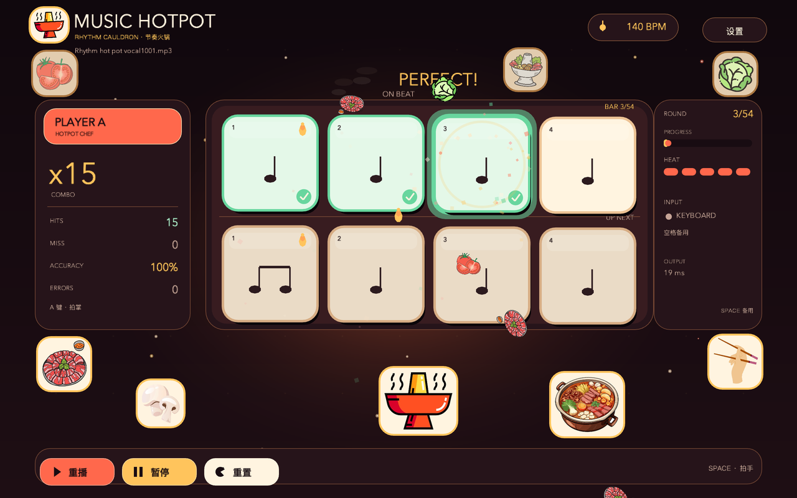
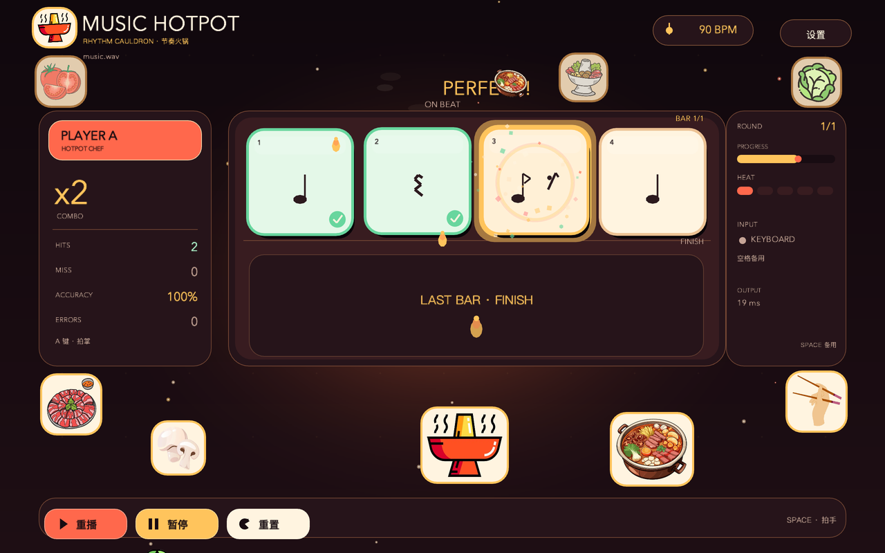
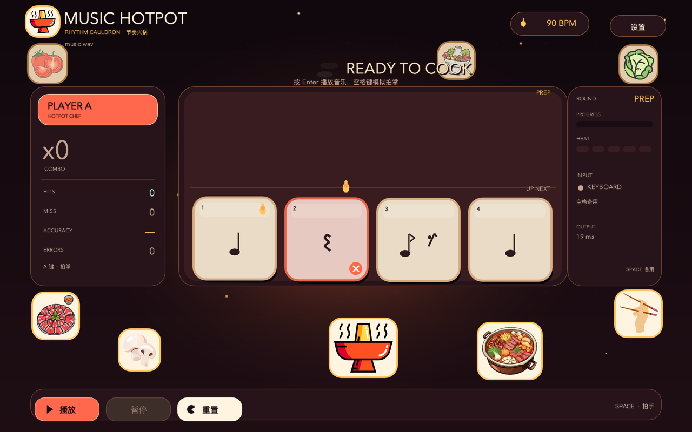
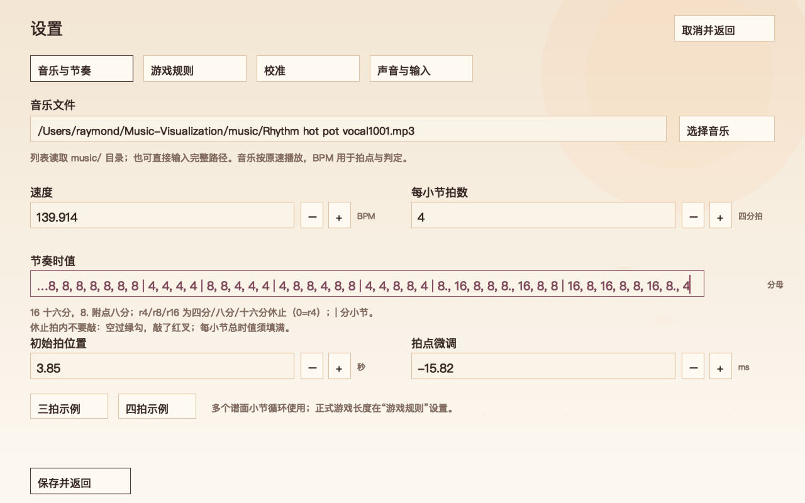

# 主音归来互动音乐剧技术系统

当前实现拍掌／节奏游戏的第 1 阶段软件链路：播放音乐、Joy-Con 拍掌与键盘备用输入、即时拍手音效、校准后的最近目标判定，以及火锅主题的 2×4 音符卡与判定动画。画面使用 **Arcade**，音乐和音效共用独立的 **sounddevice／PortAudio** 输出流。

Joy-Con 通过一个独立的 pygame 脚本发送拍掌：A 键的每次“松开→按下”只记一次，长按不重复，经本地 Unix socket 交给游戏。键盘保留作备用。原 Arduino 手套串口输入已从运行路径移除，代码与测试备份在 `experiments/serial_glove_backup/`；协议与判定链路见 [Joy-Con 输入协议](docs/joycon-input-protocol.md)。TouchDesigner 同屏、正式美术与演出联调留在后续阶段；音高检测暂不优先。

## 运行

需要 Python 3.11+。首次安装：

```sh
python3 -m venv .venv
source .venv/bin/activate
python -m pip install -r requirements.txt
python beatgame.py
```

本机已安装依赖，可直接运行 `.venv/bin/python beatgame.py`。将曲目放在 `music/`，或修改配置中的路径；音乐文件保留在本机，不随代码上传。

临时换输出设备（不改配置）：

```sh
.venv/bin/python beatgame.py --list-devices
.venv/bin/python beatgame.py --audio-device "MacBook Pro Speakers"
```

Joy-Con 需要两个终端：

```sh
# 终端 1：游戏
.venv/bin/python beatgame.py

# 终端 2：Joy-Con A 键发送器
.venv/bin/python joycon_clap_sender.py
```

先在系统设置 → 蓝牙配对 Joy-Con（按住侧面 SYNC 键 3 秒，灯快闪后连接）。发送器可以先于游戏启动；游戏没开时它会每秒重试 socket。

发送器只初始化 SDL 的视频/手柄子系统，**不初始化 pygame.mixer**；它不需要音频，避免先占用 CoreAudio 导致游戏打不开音频输出。若两个进程仍互相影响，先启动游戏，再启动发送器。

| 操作 | 效果 |
| --- | --- |
| Enter | 从头播放音乐，等待玩家拍手；暂停时继续播放 |
| Joy-Con A | 拍掌；任意拍掌可启动；等归属小节结束，完整一小节逐拍预备后进入正式游戏；首次启动前谱面为空；启动拍手不计分，按住只记一次 |
| Space | 备用拍掌，与 Joy-Con 共用同一启动、预备和判定流程 |
| R | 清空本轮，继续播放音乐并等待下一次拍手启动 |
| P | 暂停／继续，保留音乐位置与本轮结果 |
| Backspace | 从头重来，清空旧输入与结果 |
| S | 停止音乐并退出本轮 |
| F5 | 重新加载配置与素材，停止后按 Enter 重播 |
| F1 | 打开音乐选择、节奏设置与两种校准；也可点击右上角“设置” |
| Esc | 退出 |

界面为暖色火锅主题：深色锅底背景、8 张食材插图、2×4 音符卡、当前卡金色脉冲、命中彩纸和漏拍提示；主画面显示曲目、BPM、连击、命中／漏拍／正确率、当前小节与下一小节；每次正确命中还会有一份食材从音符卡弹出、受重力自然落出屏幕。卡片颜色只表达状态：当前拍金色、命中绿色、错误红色；音符本身保持墨色不变，二分及更长的音符用 HOLD 卡延续，不再出现“正确却变红”的误导。参数和校准集中在设置页。插图处理说明见 [assets/hotpot](assets/hotpot/README.md)。



休止符也会参与反馈：整段休止没有输入显示绿勾，在休止内敲击显示红叉。





节奏时值输入框支持光标、选择、复制粘贴和长文本横向滚动。



## Joy-Con 输入

默认已启用 `[input]`，游戏在 `tmp/joycon-clap.sock` 监听本地 Unix socket。拍掌由独立的 pygame 脚本产生，游戏本身不初始化 pygame，也不打开手柄：

```sh
.venv/bin/python joycon_clap_sender.py --button 1
```

- 发送器读取 Joy-Con 的 A 键（SDL 编号 `1`），只发“松开→按下”的按下沿。
- 按住不放只发一次；松开稳定 40ms 后才接受下一次，避免手抖或按键抖动重复计数。
- 每条消息带 `perf_counter()` 时间戳；游戏用它反推按下瞬间的音乐位置。
- 发送器断开时游戏继续运行，画面提示等待脚本；恢复后自动接上。设置页显示连接状态并可重启监听。
- `--release-ms` 可调松开窗口，`--button` 可换成其他按键，`--list` 列出设备，`--socket` 覆盖 socket 路径（需与 `input.socket_path` 一致）。

游戏侧收到消息后，socket 线程立即触发预载拍手声，主线程下一帧再结算判定。外部输入启用时，判定会多等 20ms 用于同帧内按音乐时间排序；声音不等待这 20ms，也不扩大判定容差。`input.max_age_ms` 只用于丢弃过旧消息，默认 250ms。

原 Arduino 串口手套输入已移除。需要恢复时见 `experiments/serial_glove_backup/README.md`，其中保留了 `glove.py`、`glove_input.py`、监测工具和测试。

## 独立配置

可在游戏设置页直接修改，也可编辑根目录 [config.toml](config.toml)，路径相对于该文件。90 BPM、4 秒首拍和 4/4 是现有示例曲目的参数；其他曲目可自行设定。当前按每首曲目一个固定 BPM 生成拍点，尚不支持曲内变速图。

| 字段 | 用途 |
| --- | --- |
| `rhythm.bpm` | 曲目四分音符速度，范围 1–600 BPM；示例曲目为 `90.0` |
| `rhythm.beat_start_seconds` | 第一个小节主拍在音乐文件中的位置，当前为 `4.0` 秒 |
| `rhythm.beat_offset_ms` | 人工统一平移整曲拍点，正值后移、负值前移；默认 `0.0` 毫秒 |
| `rhythm.note_values` | 首个谱面小节，普通数字表示分母，`"8."` 表示附点八分音符；`r4`/`r8`/`r16` 表示休止 |
| `rhythm.beats_per_bar` | 每小节四分音符拍数，当前四四拍为 `4` |
| `rhythm.patterns` | 多个完整谱面小节，按音乐小节顺序循环；首项与 `note_values` 一致 |
| `rhythm.game_bars` | 一轮正式游戏的小节数，默认 `4`；填 `0` 表示自动用满剩余音乐中的完整小节；完整预备小节另计 |
| `judgment.max_mistakes` | 正式错误达到此值即输掉，默认 `3`；`0` 表示不设上限 |
| `judgment.window_ms` | 对称判定窗口，首版试用 ±100 毫秒 |
| `judgment.input_offset_ms` | 输入延迟补偿，正值从输入时间中减去，不移动音乐或谱面 |
| `audio.blocksize` | 音频块大小，默认 128；可比较 0／64／128／256 的稳定性与延迟 |
| `audio.device` | 输出设备名称；留空使用系统默认输出 |
| `audio.clap_path` | 拍手音效路径；留空使用程序生成的短拍手声 |
| `input.enabled` | 启用本地 socket 接收 Joy-Con 脚本拍掌；默认 `true` |
| `input.socket_path` | socket 路径，相对 `config.toml`；发送器默认使用同一路径 |
| `input.max_age_ms` | 超过此时长的旧消息丢弃，默认 `250` 毫秒；不是判定容差 |

例如设置 `beat_offset_ms = 80.0`，首拍从 4.000 秒变为 4.080 秒，后续所有拍点一起后移 80 毫秒，音乐文件本身不变。窗口尺寸修改后重启程序。

当前配置提供多个四拍练习小节，含前八后十六、前十六后八、附点八分和休止；这些是 demo 谱面，不是自动从音乐中提取的正式谱。每个谱面小节必须恰好填满当前拍数。支持全、二分、四分、八分、十六分、三十二分和六十四分音符，以及最多三个附点；也支持 `r4`（四分休止）、`r8`（八分休止）、`r16`（十六分休止）等休止符，`0` 是 `r4` 的简写。暂不含跨小节延音线或三连音。音符卡用符头、符尾和符杠示意节奏，不进行音高判定；卡片按四分拍分组，八分一条符杠、十六分两条、三十二分三条，混合时值按层级分别连杠或画符尾。休止符按标准记谱绘制：四分休止为三折钩形，八分／十六分休止为斜符干加符头钩，二分／全休止为线上的方块。

### 启动、预备、正式游戏与重试

等待首次启动拍掌时显示当前小节和下一小节的预览卡，不进入判定；完成／失败后等待重来时回到预览状态。第一次拍掌成功启动后才进入预备和正式卡片。

1. 音乐拍点开始后，任意时刻拍手都可启动，不要求只在第一拍或正好踩中拍点。先按输入补偿确定拍掌的音乐位置。四拍子第 1–3 拍内属于当前小节，第 4 拍内属于下一小节；三拍子第 1–2 拍内属于当前小节，第 3 拍内属于下一小节。这里指拍内时间段，例如三拍子的第三拍起直到下个小节前都归下一小节。
2. **归属小节过完**，下一个完整小节逐个四分拍做预备，显示 `4、3、2、1` 或 `3、2、1` 倒计时。预备谱面显示四分音符，倒计时与当前拍的灯由音乐时间驱动，即使没有输入也逐拍更新；拍中另以绿色反馈。预备期间不显示正式成绩，预备命中、漏拍、多拍均不计入正确率或输赢，漏拍照常进入游戏。
3. 再下一个小节开始正式游戏，持续 `game_bars` 个小节。卡片按当前小节与下一小节翻页，命中卡变绿、漏拍卡变红，当前拍有红框脉冲和音符动画；音乐只提供播放时间和拍钟；每次正式游戏都从设置谱面的第 1 小节开始，按设置顺序推进，失败或完成后重开也从第 1 小节开始，不随音乐已经播过多少小节而跳过谱面。
4. 漏拍、多拍／错拍都可使当前四分拍记错，但每个四分拍累计错误最多加 1；同一拍内漏掉多个十六分音符或重复拍掌不连续扣错。音符命中／漏拍明细仍逐目标保留；漏拍按目标所在拍归属，额外输入按补偿后的输入所在拍归属，重试后重新计算。休止符单独结算：整段休止内没有输入则绿勾，有错误输入则红叉；休止的正确率不增加音符命中数，错误输入仍计入错误拍。正式正确率为 `命中 /（命中 + 错误次数）`，没有正式结果时显示“—”。达到 `max_mistakes` 即结束本次互动，冻结本轮成绩。成功完成或输掉都**不停止音乐**，等待新的拍掌重新走启动、预备、正式流程。预备期与正式期内不能重复触发。

例如 90 BPM、首拍 4 秒、四拍子：在第 2 拍拍手，归属第 1 小节；第 2 小节（6.667–9.333 秒）逐拍预备，第 3 小节（9.333 秒）进入正式游戏。在第 4 拍拍手则归属第 2 小节，第 3 小节预备，第 4 小节才进入游戏。

剩余音轨必须容纳完整预备和所选数量的正式小节；`game_bars = 0` 时自动取剩余音乐能容纳的完整小节数，不足一个完整小节则提示重播。`lead_in_bars` 仅为旧文件保留读取兼容，新流程固定有一个完整预备小节，页面不再提供跳过预备的选项。

判定采用最近目标、等距选较早目标。密集节奏的容差窗口可以重叠，但同一次拍掌只匹配一个最近目标，不会因为最近目标已经命中过而改判到另一个目标。

## 延迟与时间轴

音乐位置来自音频块的实际输出时间锚点，不依赖画面帧数或累计拍掌间隔。Arcade 按键回调记录时间；Joy-Con 脚本在按下沿记录 `perf_counter()`，游戏 socket 线程收到后立即触发预载音效。两者都不等待判定或画面刷新后才发声。跨进程时间戳只在同一台机器上可比；游戏会拒绝未来时间，并把超过 `max_age_ms` 的旧消息丢弃。

128 帧在 48kHz 下约为 2.67 毫秒，这只是一个块的时长。程序显示的输出延迟以及终端输出的排程到计划 DAC 输出估计，都不包含完整的 Joy-Con／按键输入、返听与空气传播链路，不能当成端到端实测。实际结果见[软件验证记录](docs/phase1-validation.md)。换硬件后需重新测量与校准。

**拍手声明显滞后时，先检查输出设备。** 程序已使用 `latency="low"`，但蓝牙耳机受编解码和传输限制，系统报告的低延迟也可能超过 100ms。运行 `beatgame.py --list-devices` 可以看到每个输出设备的低延迟；本机实测蓝牙 Honor xSport AM61 约 129ms，内置 MacBook Pro Speakers 约 19ms。把 `config.toml` 的 `[audio] device` 改成内置扬声器或有线耳机，或临时用 `--audio-device "MacBook Pro Speakers"`，通常能一次性减少 100ms 以上。代码侧 128 帧只有约 2.7ms，`blocksize=64` 最多再省约 1ms，需自行验证欠载；`input_offset_ms` 只改变判定时间，不会让声音提前。若必须使用蓝牙，声音延迟无法用代码消除，应改用有线／内置输出或接受它在演出流程中的位置。

## 游戏内音乐选择、节奏设置与校准

点击右上角“设置”或按 F1，进入后停止音乐并清空本轮。页面分为“音乐与节奏”“游戏规则”“校准”“声音与输入”：

- **音乐与节奏**：点击“选择音乐”浏览本机 `music/`（含子目录），或直接输入其他音频的路径。可以编辑 BPM、每小节四分拍数、节奏时值、初始拍位置、拍点微调。音乐保持原速播放，BPM 改变目标拍点间距。列表按本机解码器支持的 WAV、MP3、OGG、FLAC、AIFF 等格式筛选，打开时再检查内容是否可解码。
- **节奏时值**：逗号或空格分隔，`16` 表示十六分，`8.` 表示附点八分，`4..` 表示复附点四分；`r4`、`r8`、`r16` 分别表示四分、八分、十六分休止，`0` 等价于 `r4`。用 `|` 分隔不同小节。例如三拍可填 `8,16,16,8.,r16,4 | 16,16,8,16,8.,4`。页面有“三拍示例”“四拍示例”按钮，可填入后继续编辑。总时值须按小节分别填满；当前支持 3/4、4/4 等以四分音符为单位的拍号，不把 6/8 复合拍的强弱规则当作已经实现。休止拍内不敲击，休止结束显示绿勾；在休止内敲击显示红叉并计入错误。
- **游戏规则**：正式游戏小节数与输掉所需错误数；小节数填 `0` 表示自动用满剩余音乐，错误上限 `0` 表示不设限制。预备练习始终为一个完整小节。
- **声音与输入**：输入补偿、判定容差、音频缓冲、两路音量，以及 Joy-Con 脚本的连接状态与“重启监听”。

输入框是普通单行文本框：点击定位光标，左右方向键、Home/End 移动，Shift+方向键选择，支持 Cmd/Ctrl+C、V、X、A 复制粘贴和全选；Tab 切换，数字字段可用加减或方向键微调。点击“保存并返回”写入 `config.toml` 并重建实际音轨、拍点和判定。取消返回放弃草稿。当前只保存选中曲目与一套参数，不按曲目自动识别或记忆独立参数方案；切换音乐后请核对 BPM、首拍和模板。

建议先速度校准，再初始拍校准。两种校准都支持 Joy-Con 与备用空格键；播放从文件开头开始，在音乐节拍进入后逐个四分音符跟拍。至少 8 拍，稳定满 16 拍自动结束，也可点“完成”或按 Enter；32 拍仍不稳定时结束并提示重新采样。

1. **速度校准**独立使用连续拍掌间隔的稳健中位数估计 BPM，不吸附现有速度或首拍。少量异常间隔可排除；结果显示有效拍数与建议速度，点击“采用结果”更新草稿 BPM。持续隔拍、每拍两次与真正的半速／倍速无法仅靠拍掌区分，需本人试听核对。
2. **初始拍校准**使用草稿 BPM、初始拍位置和输入补偿，估计当前起点附近 ±半拍的偏移。采用后更新拍点微调；整拍或整小节错位先手动改初始拍位置。此模式仍显示平均跟拍 BPM，方便核对设定速度。
3. 采用结果后点击“保存并返回”。校准试听使用当前选中曲目和草稿参数，但不写配置文件；取消返回恢复已保存的曲目和参数。修改曲目、速度、初始拍、微调或输入补偿会清除旧校准结果。

跟拍结果包含人的偏差，不能独立测出硬件和返听延迟。

无效参数、配置被外部修改、设备打开失败或保存失败时，不会覆盖原配置；页面会显示原因。

## 检查与验证

```sh
python beatgame.py --check
python beatgame.py --list-devices
python -m unittest discover -s tests
python beatgame.py --demo-seconds 22 --screenshot tmp/rounds-live-result.png
```

`--check` 只验证配置、解码音乐与生成目标，不打开音频设备。自动验证会播放音乐并注入已知拍掌时间戳，明确标为软件验证；不能替代真实 Joy-Con、按键或音频延迟测试。每次练习的配置、输入时间、匹配目标与判定结果写入本机 `logs/`。

## 开发资料与同步范围

- [规则与画面要求](docs/rhythm-game-rules.md)
- [分阶段开发计划](docs/rhythm-development-plan.md)
- [第 1 阶段软件验证](docs/phase1-validation.md)
- [Joy-Con 输入协议与判定链路](docs/joycon-input-protocol.md)
- [Arduino 手套串口验证（历史记录）](docs/glove-serial-validation.md)
- [串口手套代码备份](experiments/serial_glove_backup/README.md)
- `experiments/interval_judge.py` 保留早期命令行判定实验。

代码、配置、开发文档和 UI 历史参考图纳入仓库。音乐、日志、临时截图、IDE 配置、本机协作约定及早期选型调查保留在本地。
