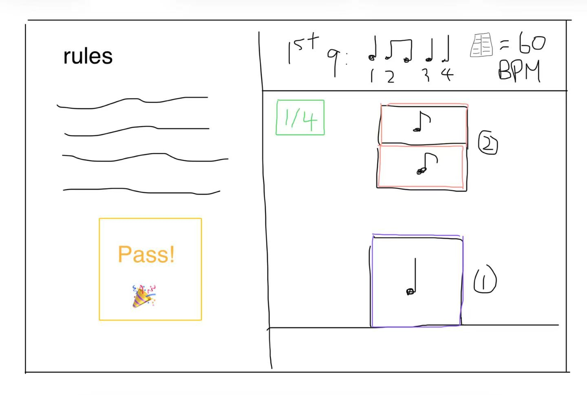

# 拍掌节奏游戏规则与画面参考

首次记录：2026 年 10 月 16 日；更新：2026 年 10 月 19 日。依据：用户口述、初始 UI 草图及后续修正。本文区分已确认规则、首版软件设置和待确认项；键盘软件链路与手套首轮游戏贯通已完成，现场绝对延迟与演出验收仍待验证。

## 2026 年 10 月 19 日谱面起点与预备显示修正

用户进一步明确：谱面小节不跟随音乐的累计小节编号，每次启动完成预备之后，必须从设置谱面的第 1 小节开始，重试同样从第 1 小节开始。音乐仍提供统一拍钟与实际时间，不将其已播过的小节作为谱面起点。

后续补充：正式游戏每个四分拍最多计 1 次错误，漏拍、错拍与重复拍共享额度；下一拍和新轮次重新计算。音符判定明细仍保留，失败上限按出错拍数累计。

预备拍不计正确率，预备期间隐藏正式命中／漏拍／错误和正确率。倒计时与当前灯按拍钟逐拍推进，无输入也正常显示 4、3、2、1；拍中反馈单独显示为绿色。正式正确率只用本轮正式命中和错误计算，尚无正式结果显示“—”。

手套首次启动与空格共用同一游戏入口，不要求键盘预先触发；实际握手未就绪时显示连接／松开提示。硬件首次启动验证与软件报文链路检查分别记录在验证文档。

## 2026 年 10 月 19 日节奏与轮次扩展（最新规则）

以下替代较早的“仅第一拍启动、预备后只打一小节”试用规则。

- 游戏窗口不显示项目名或 demo 页面大标题，窗口标题仅为“节奏练习”；设置页使用普通“设置”标题。
- 首次启动拍掌前不显示五线谱音符、符杠、附点、小节编号或节奏标记，只保留空谱线与拍号；完成或失败后等待重开时同样清空。启动成功后才展开谱面。
- 支持十六分、附点及对应渲染。输入 `8.` 表示附点八分、`4..` 表示复附点四分，最多三个附点；混合节奏按四分拍连接符杠，包含前八后十六、前十六后八及附点八分加十六分的正反排列。原有全、二分、四分、八分和更短常规时值保留；休止与三连音未列入此次实现。
- 支持三拍子（3/4）；每小节拍数、时值模板与倒计时同步变化。用 `|` 编辑多个不同的完整谱面小节，每轮从设置的第 1 小节依次循环；正式游戏长度独立设置，五线谱随音频时钟连续滚动。
- 音乐拍点开始后不要求踩第一拍或正拍才启动。四拍子的前三拍内拍掌归当前小节，最后一拍内归下一小节；三拍子的前两拍归当前，最后一拍归下一小节。按已补偿的拍掌位置判断，最后一拍边界归下一小节。
- 归属小节结束之后，下一个完整小节逐拍拍手预备，显示倒计时，再进入正式小节。**用户补充确认：预备只作练习，漏拍也进入正式游戏，不计输赢错误。**
- 正式游戏允许多个小节，默认 4 小节，可在设置中修改。剩余音乐不足以容纳完整流程时不启动截短游戏，并显示重播／减少长度提示。
- 新增错误上限，默认 3 次，达到上限输掉；0 表示不设上限。**用户补充确认：漏拍、多拍／错拍都计错；已经记过漏拍的目标，迟来的补拍不重复扣一次。**失败后冻结本轮后续判定；完成或失败仅结束互动，音乐继续，新拍掌可再次启动完整流程。
- 保持白底 demo；手套、键盘备用、即时音效和延迟补偿路线不变。新功能软件和原生窗口验证见[验证记录](phase1-validation.md)，不声称新增实物跟拍或声学测量。

## 2026 年 10 月 19 日 demo 与可配置内容

用户要求开放速度与节拍、加入音乐选择，校准分为速度与已有的初始拍两种；UI 改为白底的简洁 demo，留给后续设计人员优化。

- 游戏设置可选择 `music/` 中的音频，或输入其他音频路径；保存后实际切换播放器与判定曲目。当前保存一首选中曲目和一套参数，不自动提取谱面或管理多首独立谱面。
- BPM、每小节四分拍数、节奏模板、初始拍位置、拍点微调和预备小节均可修改。90 BPM、4 秒首拍和四四拍仅属于此前的示例曲目。BPM 调整拍点间距，音乐保持原速；每首曲目当前仍按一个固定 BPM 处理。
- 速度校准从连续四分音符跟拍间隔估计 BPM，不依赖原 BPM；采用结果更新草稿。初始拍校准使用草稿 BPM 估计当前起点附近的相位，整拍错位手动粗调。
- 两种校准支持手套与备用空格，试听选中曲目与草稿，保存才写入配置；取消恢复原配置。先校准速度，再校准初始拍。
- 白底、灰色分隔线、普通矩形按钮；继续保留五线谱、下落短线和必要操作反馈，正式美术仍留待后续设计。

## 2026 年 10 月 18 日手套输入补充

用户已接入 Arduino Nano，所给固件读取无线开关的 D2 数字电平，接触／离开分别发送 `1,<millis>`、`0,<millis>`，115200 baud。当前信号不是主机采集的连续模拟量；下文早期“模拟信号”描述以此次实际硬件补充为准。已有真实串口接收记录，但持续合掌超时重新触发、真实接触对应、断连与时钟映射仍需处理，见[验证记录](glove-serial-validation.md)。拍掌事件仍须与节奏正确分开，不能直接把每条接触记录视为合格拍掌。

后续已按要求把 30ms 稳定去抖接入游戏与校准；手套确认后直接触发音效，按原始接收边沿参与判定，空格作为备用。停止、暂停期间不计拍，穿戴完成后再播放、停止后再摘下。穿戴／摘下若发生在播放中，仍可能形成输入，不能仅靠去抖识别意图。实物试玩已完成一轮手套启动、5 命中／0 漏拍，具体测试条件与尚未覆盖的项目见同一验证记录。

## 2026 年 10 月 18 日界面精简

用户要求删除不必要的指示，保持简洁。主画面取消规则说明面板、开发阶段与输入模式标签、目标序号／秒数、首拍与偏移参数、播放计时、延迟／欠载读数和快捷键列表。五线谱与下落短线改为居中；保留教学拍数、预备计拍、简短判定／完成反馈、命中／漏拍、BPM 和设置入口。播放、暂停和重置按当前状态显示。

设置页保留参数及单位、首拍预览、平均跟拍 BPM 与差值、有效拍数和校准结果。重复操作说明和常驻技术说明删除；只有选中参数时显示简短含义，校准失败或设置错误仍显示原因。此次只调整呈现，不修改判定、校准或声音规则。

## 2026 年 10 月 17 日确认与画面修正

- 已提供本地音乐；全曲匀速，四分音符 = 90，拍点从文件 4.0 秒处开始。
- 使用独立 `config.toml`，提供人工可调整的 `rhythm.beat_offset_ms`，统一平移全曲拍点。正值后移，负值前移；音乐仍从文件开头播放，保留前 4 秒。
- 先完成第 1 阶段软件链路，手套暂不接入，使用键盘模拟拍掌。
- 画面与窗口使用 Arcade，音频播放和判定保持独立模块。
- **下落目标改为短横线**，每条对应一次瞬时拍掌；不沿用原草图的音符长块，不要求持续合掌。
- **在下落区域上方显示五线谱**，用于音乐教育，展示目标的四分／八分等时值。尚无旋律谱时，以固定音高示意节奏，不能据此声称在显示或判定曲目的真实音高。
- **首次拍掌决定开始**：曲目为四四拍，玩家在任意小节第一拍拍手启动本轮。最新试用方式是先预备一个小节，再在下个小节第一拍开始正式打一个小节；启动拍手不计入成绩。
- **拍手后才出现下落条**：等待期间只保留五线谱，成功启动后显示本小节短线，不自动展开后续小节。
- **游戏内设置与首拍校准**：提供手动延迟补偿等设置；播放音乐后要求跟拍，估计整曲拍点开始位置。当前实现以键盘采样，建议值先预览，再选择采用并保存；输入补偿与拍点偏移独立，不把主观跟拍当成硬件延迟测量。

首版用 `[4, 8, 8, 4, 4]` 的四拍模板验证链路；这是可修改的练习设置，不是正式曲目谱面。`±100ms` 容差及命中／漏拍计数为首版试用行为，仍需排练确认。首拍启动也使用校准后的这一容差；下一轮由新的小节第一拍拍手重新启动。`lead_in_bars = 1` 表示预备一小节；设为 `0` 可比较此前“启动拍手计入第一拍、立即打一小节”的方式。

## 已确认规则

1. **进入时机与长度**：玩家在任意小节第一拍拍手启动，预备一小节后进入正式判定；每轮正式打一个小节。
2. **判定依据**：开始后，将拍掌时机与离它最近的音乐目标拍点比较。目标来自本段实际要求拍出的节奏，不能把所有输入都吸附到固定四分音符网格。
3. **节奏内容**：支持不同音符时值组合，例如“四分音符＋两个八分音符”。四四拍是说明拍号的例子，不是全项目仅支持四四拍的限制。
4. **音乐播放**：背景音乐播放必须集成到系统。音乐开始播放时启用手套输入的接收与判定流程，使用音乐播放位置确定目标时间。
5. **输入与校准**：接收手套输入，识别出拍掌事件，校准时间后，判断它是否落在最近目标拍点允许的偏差范围内。当前硬件路径为数字接触／离开串口事件，具体有效拍掌、去抖与时钟映射需经实物验证。
6. **即时音效**：戴手套拍掌需要由系统集成播放低延迟音效，作为及时的拍掌反馈。具体允许延迟仍需实物测试和演员确认。
7. **画面方向**：制作类似音游的界面，包含节奏提示、五线谱、下落短横线、判定线及结果反馈。拍手启动后才出现本小节下落条；以 10 月 17 日的修正为准，初始图中的数值和未解释标记不能直接变成玩法规则。

音乐播放与游戏轮次分开：Enter 只开始音乐，等待玩家在小节第一拍拍手；等待和预备期间不结算正式成绩。预备结束后正式打一个小节，结束后保留结果，音乐持续播放，不自动进入下一轮。

## 判定流程的开发建议

以下把已确认规则展开为可实现流程；事件归属、重复与漏拍处理仍属于建议，不能替代玩法确认。

1. 加载并校对伴奏、目标拍点表、小节／主拍位置与拍掌音效，预加载声音资源。
2. 开始播放，建立音频内容位置与输入计时时钟的对应关系，同时启用手套输入流程。音乐播放位置持续前进，不因某次拍掌提前或落后而重置。
3. 等待校准后的拍掌落在小节第一拍容差内，以此触发预备；下一个小节才是正式目标小节。启动拍手不计分，启动后显示正式小节短线，并在一小节预备后开始判定。首版使用循环模板，正式曲目节奏待音乐组提供。
4. 从手套模拟量识别接触与松开，用阈值／滞回及去抖策略将一次接触过程转为一次拍掌事件。持续合掌不能不断生成新事件；参数依实物波形确定。
5. 有效拍掌事件到达后，尽快触发预加载音效；校准与判定使用同一事件。建议声音路径独立于画面刷新，并且不等待命中结果或下一拍才发声。未命中是否也发声、非游戏状态能否试听，待确认。
6. 将事件时间映射到统一时间基准，补偿已测得的输入、播放／返听偏移，再找本轮中距离最近的目标落点。
7. 计算有符号时间误差：`误差 = 校准后的拍掌时间 - 目标时间`。负值为早拍、正值为晚拍。若采用对称容差，`abs(误差) <= 容差` 为命中；是否对称及端点是否包含，属于待确认参数。
8. 输出目标标识、误差、命中结果和视觉反馈，保留必要日志供校准与排练复查。漏拍、多拍、重复命中及 Pass 规则确认后，再加入结算。

校准只改变比较的时间依据，不能消除真实发声延迟，也不能让迟到的声音回到过去。不同设备时钟需要映射后再比较；不得重复补偿同一段声卡延迟。建议将接触发生时刻与目标声音到达演员耳边的时刻比较：若输入到达主机时刻为 `R`、输入延迟为 `I`、目标到达声卡实际输出的时刻为 `H`、后续返听延迟为 `M`，则示意误差为 `(R - I) - (H + M)`。各项须使用同一时间基准，并通过测量校准；音频渲染游标不能直接当成此刻实际出声的位置。

### 细分节奏示例

仅作算例：四分音符为一拍、60 BPM，按“四分音符＋八分音符＋八分音符”的顺序从起点 `T` 连续演奏，则三个起音位置是 `T`、`T + 1.0 s`、`T + 1.5 s`，整组时值为 2 拍，持续到 `T + 2.0 s`。本例不是完整四四拍小节，也不把 60 BPM 设为正式速度。

在 `T + 1.46 s` 拍掌，应比较 `T + 1.5 s` 的目标，误差为 `-40 ms`，不能改为比较 `T + 1.0 s` 的四分音符网格。是否命中由最终容差决定；下一目标仍跟随原音乐时间轴。

### 最近目标的边界处理

已确认的是“最近目标拍点＋容差”，以下细节尚未确认，建议首版采用一致且可测试的规则：

- 只在当前轮次、当前参与者对应的目标序列内寻找最近目标；多人分组方式待定。
- 先找最近目标，再检查是否已命中；建议已命中目标附近的重复拍掌不转而命中更远目标，避免无意改变“最近”的含义。
- 每次拍掌最多命中一个目标，每个目标对同一参与者最多命中一次。
- 恰好在两个目标中点时建议归到较早目标；需连同窗口重叠情况一起确认。
- 超出容差的事件如何显示或计分、未输入目标何时记漏拍，尚未决定。最终结算应考虑输入传输的处理余量，避免在事件抵达前误判漏拍。

## 初始 UI 草图记录（历史参考）

下图保留最初讨论背景；**音符长块已被 10 月 17 日的下落短线与五线谱要求替代**。以下表格记录原图，不再作为下落目标外观的实现依据。

草图作为画面方向保存；以下是对图中可见元素的记录，未解释的语义保留待确认。

| 位置 | 图中内容 | 实现时的处理 |
| --- | --- | --- |
| 左侧大区域 | `rules` 标题及多行说明 | 放规则与参与提示，最终文案待定 |
| 左侧下部 | 黄色边框、`Pass!` 与庆祝图案 | 通过反馈的视觉参考；触发条件、时长和失败反馈待定 |
| 右侧顶部 | `1st`、节奏音符、拍数标注和 `60 BPM` | 显示当前节奏／轮次和速度；`1st` 含义及正式速度待定 |
| 右侧左上 | 绿色 `1/4` | 保留显示位置；可能涉及进度，其确切含义待确认 |
| 右侧主体 | 纵向排列、不同大小和颜色边框的音符块，旁有圈号 | 保留音符块与排列方向；大小／颜色／圈号编码、移动方式及是否对应时值待确认 |
| 右侧底部 | 一条水平线，最下方音符块贴近该线 | 建议作为音符到达的判定线；移动方向、到线时刻和命中动画待确认 |

当前按音乐时间轴让短横线接近底部判定线，在拍掌后显示命中／早晚误差。五线谱展示节奏时值，短线本身不以长度或高度表示保持时长。

音乐可视化同屏要求继续保留。草图尚未明确其位置，不能自行把左侧规则区改成可视化区；在布局确认前，用简单视觉做合成验证。

## 仍需确认

- 正式节奏使用曲目各小节预先配置的目标，还是始终使用同一个小节模板？
- 容差单位、早晚窗口、判定分级、重复拍掌、多拍、漏拍和 Pass 条件是什么？
- 音效是否每次有效拍掌都响，未命中及等待／暂停期间如何处理？
- 若正式界面仍需 `1st`、`1/4`、圈号等旧草图标记，具体语义是什么？首版不擅自引入这些进度／结算规则。

伴奏已到位；后续还需确认正式目标节奏、演出电脑、手套采集与通信设备、参与人数、音效素材，以及现场操作与异常恢复方式。开发顺序见[开发计划](rhythm-development-plan.md)。
